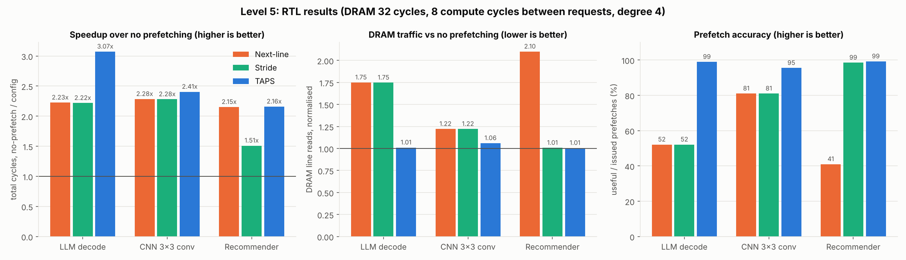
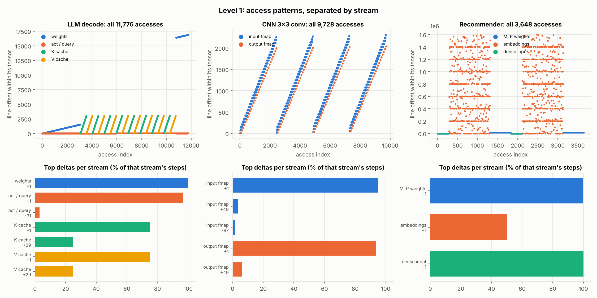
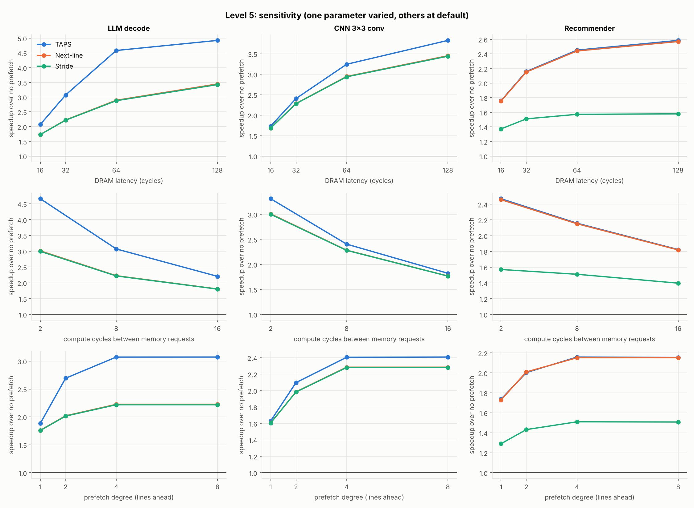

# TAPS: Tile-Aware Prefetching for AI memory streams

Entry for Micron's **AI-Aware Cache & Prefetch Engine RTL Challenge**.

AI kernels rarely read memory as one long stride. A KV cache is read one head at a
time (a few contiguous lines, then a jump to the next token), a convolution reads a
segment of each input row (a run, then a jump to the next row), and an embedding
lookup reads one fixed-size row at an unpredictable place. TAPS models a stream as
a sequence of **rows**: `run` steps of stride `s1`, then a jump `s2`. It learns the
row shape and the jump separately, so it can:

- prefetch straight across row boundaries when the jump is regular (KV cache, conv), and
- still prefetch to the end of each row when the jump is random (embedding tables).

## Results

Default setup: 16 KB 4-way cache, 64 B lines, DRAM latency 32 cycles, one DRAM
request every 2 cycles, 8 compute cycles between memory requests, prefetch degree 4.



| Workload | Best baseline | TAPS | TAPS vs best baseline |
|---|---|---|---|
| LLM decode | 180,522 cycles (next-line), 14,431 DRAM reads | **130,752 cycles, 8,335 DRAM reads** | 28% fewer cycles, 42% less DRAM traffic |
| CNN 3x3 conv | 115,725 cycles (next-line), 5,824 DRAM reads | **109,917 cycles, 5,056 DRAM reads** | 5% fewer cycles, 13% less DRAM traffic |
| Recommender | 71,945 cycles (next-line), 7,301 DRAM reads | **71,714 cycles, 3,496 DRAM reads** | same speed, 52% less DRAM traffic |

TAPS prefetch accuracy is 95-99% on all three workloads; next-line is 41-81%.
The full table, including the ablation, is in [`results/summary.md`](results/summary.md).

## How it works

```
 AI core ──req──▶ ┌──────────────────────────┐ ──demand miss──▶ ┌────────┐
                  │ cache_ctrl               │                  │  DRAM  │
          ◀─resp─ │ 16 KB, 4-way, tree-PLRU  │ ──prefetch────▶  │ model  │
                  │ 8 prefetch MSHRs         │ ◀──fill───────── └────────┘
                  └─────┬──────────────▲─────┘
              train (addr,│stream,kind)  │ prefetch addr
                  ┌─────▼──────────────┴─────┐
                  │ prefetch_engine          │
                  │ 8 stream entries         │
                  │ round-robin issue        │
                  └──────────────────────────┘
```

**Streams.** Every request carries a 3-bit stream ID naming the tensor it belongs to
(weights, activations, K, V, ...). An accelerator's load unit knows this, the same way
a CPU prefetcher knows the PC. Each ID gets its own table entry, so interleaved
tensors don't corrupt each other's pattern.

**What trains the prefetcher.** Misses and first touches of prefetched lines always
train. A hit on a normal line trains only if it is the exact address the stream
predicted. Without this filter, ordinary data reuse (re-reading an activation, a
step back inside a tile) looks like a broken stride.

**Per-stream state (TAPS).**

| Field | Meaning |
|---|---|
| `s1`, `run`, `rok` | step inside a row, steps per row, row length seen twice |
| `s2`, `wok` | jump to the next row, jump seen twice |
| `c1`, `cw` | 3-bit confidence in the row shape and in the jump (+1 hit, -2 miss) |
| `pos` | position inside the current row |
| frontier, `ahead` | last prefetched address and how far ahead of demand it is |

When the frontier reaches the end of a row, TAPS prefetches the jump only if `cw`
is high; otherwise it stops and waits for the next demand access to show where the
new row starts. That is what lets it handle embedding rows (2 lines each, random
row order) at 99% accuracy.

**Issue.** Each stream may run up to `DEGREE` lines ahead of demand. A round-robin
arbiter sends one prefetch per cycle when the cache has a free MSHR and a DRAM slot.
Prefetches for lines already cached or in flight are dropped.

**Cache timing model.** Hits take 1 cycle. Demand misses and prefetches both take
`DRAM_LATENCY` cycles. DRAM accepts one request every `DRAM_ISSUE_GAP` cycles, and
demand misses go first. A demand that finds its line still in flight waits for the
remaining cycles and is counted as a *late* prefetch, not a hit. The cache stores
tags only (no data array); it is a timing and hit-rate model.

## Levels

| Level | Where |
|---|---|
| 1. Trace analysis | `gen_traces.py`, `figures/level1_trace_analysis.png` |
| 2. Cache architecture | `scripts/ref_model.py`, `results/level2_sweep.csv`, `figures/level2_cache_sweep.png` |
| 3. Prefetch strategy | `rtl/prefetch_engine.v` (next-line, stride, TAPS) |
| 4. RTL | `rtl/cache_ctrl.v`, `rtl/prefetch_engine.v`, `rtl/mem_subsystem.v`, `tb/tb_mem.v` |
| 5. Validation | `results/*.csv`, `figures/level5_*.png`, `results/golden_check.txt` |

### Level 1: traces

The traces are generated from the loop nests of three kernels (fp16 everywhere):

- **LLM decode**: one layer, one token. GEMV over the QKV and output weights, then
  attention over a 96-token KV cache with 8 heads of 128 elements. The KV cache is
  token-major (`K[token][head][dim]`), so reading one head is 4 lines, then a jump of
  29 lines to the next token.
- **CNN**: 3x3 conv, NHWC, 64 channels, 32x32 output, tiles of 8 output columns.
  Each output row reads a 20-line segment from three input rows.
- **Recommender**: DLRM-style. Bottom MLP, 8 embedding tables of 100k rows with
  Zipf-distributed indices (each row is 2 lines), then the top MLP.




### Level 5: sensitivity



_Notes to be added once the sweeps finish._

## Findings worth noting

- **Anti-pollution hurt.** Evicting unused prefetched lines first and not
  promoting them in PLRU was meant to protect demand data. With an accurate
  prefetcher it does the opposite: it evicts prefetched lines before they are used.
  TAPS on CNN drops from 2.41x to 2.29x with it on. It is off by default and kept as
  a parameter (`ANTI_POLLUTE`).
- **The training filter mattered more than the predictor.** The first version of
  TAPS trained on every access and lost to a plain stride prefetcher, because a
  single step back to a cached line cut its confidence.
- **Stride prefetchers fail on KV caches.** With 4-line heads the delta pattern is
  `+1 +1 +1 +29`. A stride prefetcher never sees the same delta often enough to switch to
  +29, so it behaves like next-line and keeps prefetching past the end of every
  head (about 6,000 useless prefetches on the LLM trace, vs 80 for TAPS).

## Verification

- `results/golden_check.txt`: with prefetching off, the RTL hit count matches the
  Python reference model exactly on every trace.
- The testbench checks that each configuration counted every request.

## Running it (VS Code + Icarus Verilog)

### 1. Install the tools

macOS:

```bash
brew install icarus-verilog                 # iverilog + vvp
python3 -m pip install numpy matplotlib     # traces and plots
xcode-select --install                      # provides `make`, if missing
```

Windows: install Icarus Verilog from bleyer.org/icarus (tick "add to PATH"), then
`pip install numpy matplotlib`. There is no `make`, so use the commands in step 4.

Linux: `sudo apt install iverilog` and `pip install numpy matplotlib`.

Check with `iverilog -V`.

### 2. Open the project in VS Code

```bash
git clone https://github.com/HRS-17/Micron.git
cd Micron
code .
```

Useful extensions:
- **Verilog-HDL/SystemVerilog/Bluespec SystemVerilog** (mshr-h): highlighting and iverilog linting
- **Surfer** or **WaveTrace**: view `.vcd` waveforms inside VS Code

### 3. Run everything (integrated terminal, Ctrl + `)

```bash
make quick     # traces, main RTL run of all 6 configs, golden check  (~1 min)
make plots     # regenerate figures/ from results/
make           # everything, including all sweeps                    (20+ min)
```

`make quick` should print `MATCH` three times and write `results/rtl_results.csv`.

### 4. Run one simulation by hand (any OS)

```bash
python3 gen_traces.py                         # writes traces/*.hex
mkdir -p build results
iverilog -g2012 -o build/sim tb/tb_mem.v rtl/cache_ctrl.v rtl/prefetch_engine.v rtl/mem_subsystem.v
vvp -n build/sim +trace=traces/trace_llm.hex +name=llm +csv=results/my_run.csv
```

It prints one line per configuration and appends the same numbers to the CSV:

| cfg | prefetcher |
|---|---|
| 0 | none |
| 1 | next-line |
| 2 | stride |
| 3 | stride + anti-pollution |
| 4 | TAPS |
| 5 | TAPS + anti-pollution |

Use `trace_cnn.hex` / `trace_rec.hex` (with `+name=cnn` / `+name=rec`) for the
other workloads.

To change parameters, add `-P` flags when compiling:

```bash
iverilog -g2012 -Ptb_mem.DRAM_LAT=64 -Ptb_mem.DEGREE=8 -o build/sim tb/tb_mem.v rtl/*.v
```

| Parameter | Default | Meaning |
|---|---|---|
| `DRAM_LAT` | 32 | DRAM latency in cycles |
| `GAP` | 8 | compute cycles between memory requests |
| `DEGREE` | 4 | how many lines a stream may run ahead |
| `ISSUE_GAP` | 2 | cycles between DRAM requests (bandwidth) |

### 5. Waveforms

```bash
vvp -n build/sim +trace=traces/trace_rec.hex +name=rec +csv=build/w.csv +dump
```

This writes `waveform.vcd` (`make wave` does the same). Open it with Surfer or
WaveTrace in VS Code, or with GTKWave. The recommender trace is the shortest;
the other traces give much larger files. Good signals to start with:

- `tb_mem.cfg[4].dut.u_pf.e_c1`, `e_cw`, `e_pos`, `e_run`: TAPS learning each stream
- `tb_mem.cfg[4].dut.u_cache.pf_req_valid`, `pf_req_ready`: prefetch issue
- `tb_mem.cfg[4].resp_ready`, `resp_hit`: demand responses

### 6. Optional: one-click run

The repo already includes `.vscode/tasks.json`. Use Terminal → Run Build Task (Ctrl/Cmd + Shift + B):

```json
{
  "version": "2.0.0",
  "tasks": [
    { "label": "TAPS quick run", "type": "shell", "command": "make quick",
      "group": { "kind": "build", "isDefault": true } }
  ]
}
```

## Limitations

- Tag-only cache and a fixed-latency DRAM model (no banks, no row-buffer effects).
- Reads only; output writes are modelled as reads that allocate.
- Single-level cache, one outstanding demand request (an in-order core).
- Traces are synthetic, but each follows a real kernel's loop nest.
- Stream IDs are assumed to come from the accelerator's load unit.
